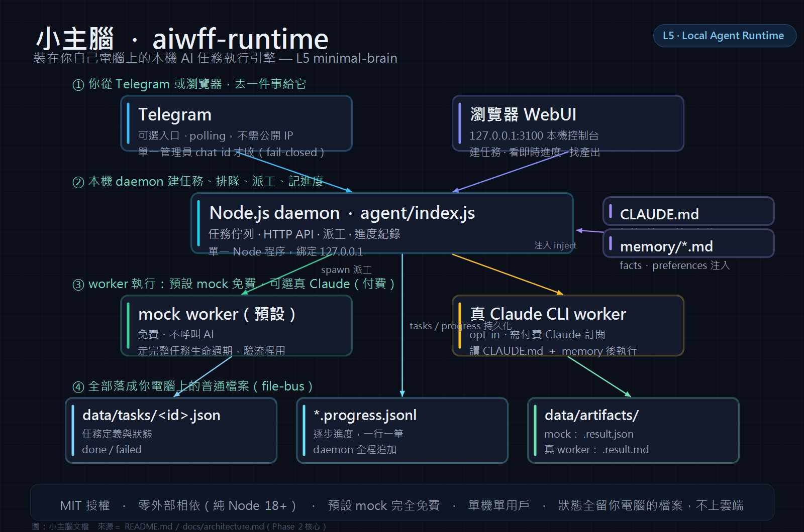
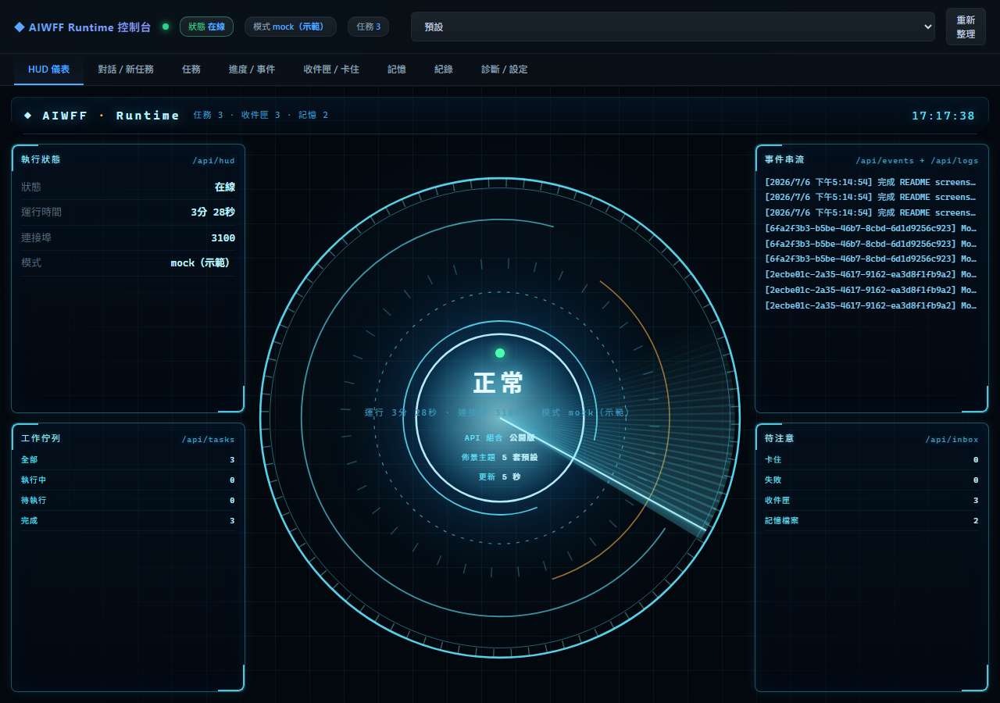
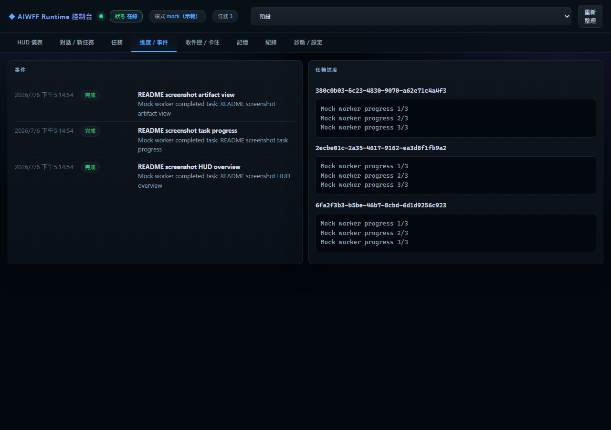
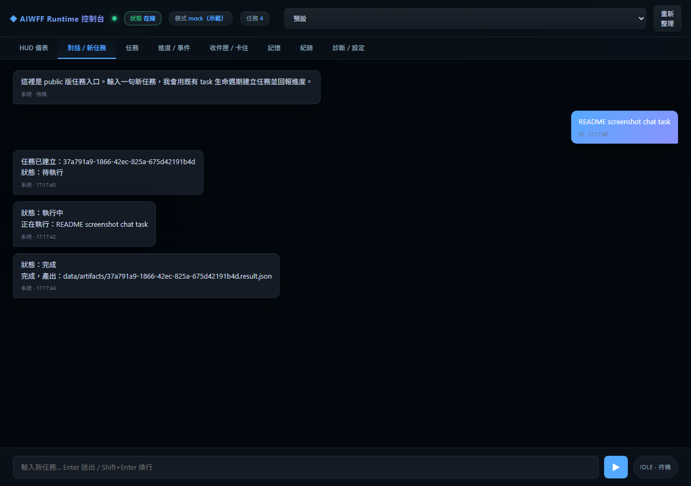

# aiwff-runtime

> English spec -> [README.md](README.md) · 安裝手冊 -> [docs/zh-TW/install.md](docs/zh-TW/install.md) · 使用手冊 -> [docs/zh-TW/usage.md](docs/zh-TW/usage.md)


[](README.zh-TW.md)

每件任務留收據。然後才是 Telegram。然後才是 Claude。

這版預設 mock。真 worker 是 Claude CLI。Gemini 與 Codex 這版沒接成 worker。換引擎是以後的事。

aiwff-runtime 跑在你的電腦上。你丟一件事。worker 跑完。結果是一份檔。瀏覽器看得到進度。OpenAI 相容端點是選用，預設關閉。



## 這是什麼？

aiwff-runtime 是單機任務引擎。人丟一件事。worker 跑完。結果是一份檔。它在你的電腦上常駐一個 daemon，也就是背景一直跑、負責收任務和派工的 Node.js 程式。你可以從 WebUI 建立任務、看進度、找結果。

先把兩個會一直出現的詞說清楚：artifact 是任務完成後留下來的成果檔；file-bus 是用一般檔案傳任務、進度和結果，不需要額外的資料庫。

| 常見誤會 | 實際情況 |
|---|---|
| 只是另一個聊天視窗 | 它會建立任務、派 worker、寫 artifact，並回報完成狀態 |
| 只是包一層模型 API | 它用你的電腦、你的檔案、你的 Claude CLI 來跑 |
| 所有步驟都要先畫成固定流程 | 它收一段任務指令後，讓 Claude 在設定邊界內規劃和用工具 |
| 任務、進度和結果 | 寫在這個專案資料夾的檔案裡。 |

最短流程長這樣：

```text
Telegram message
  -> local daemon creates a task
  -> Claude CLI reads CLAUDE.md and runs the task
  -> result is written under data/artifacts/
  -> Telegram and WebUI show the outcome
```

## 它在 AI 工具層級裡的位置

| 層級 | 常見形態 | 那一層通常做什麼 | aiwff-runtime 的位置 |
|---|---|---|---|
| L1 | ChatGPT.com / Claude.ai | 打開聊天、回答一次、對話結束 | 在它下面 |
| L2 | API wrapper | 把模型 API 包成自己的介面 | 在它下面 |
| L3 | IDE 或 CLI assistant | 可以用工具，但狀態多半跟著單次 session | 在它下面 |
| L4 | n8n / Make / Zapier | 事先畫好的流程照路線跑 | 在它下面 |
| L5 | Local agent runtime | 收任務、規劃、用工具、保留任務狀態 | **aiwff-runtime 是單機任務引擎。** |
| L6 | Multi-node orchestration | 多台機器、多個 agent 協作 | 完整 AIWFF |

aiwff-runtime 是 L5 基底：單機、可看見、可驗證的任務執行環。完整 AIWFF 則是更大的 L6 多節點系統。

## 架構

minimal-brain 設計有 8 個元件。Phase 2 先做最實用的核心：daemon、Telegram polling（daemon 定期去查 Telegram 有沒有新訊息）、Claude CLI worker、file-bus、WebUI、`CLAUDE.md` 大腦設定、輕量 memory 注入（把記憶文字放進任務提示）。

上面的架構圖讓你先看整體關係。想看更偏 source 的對照表，請看 [docs/architecture.md](docs/architecture.md)。

| 元件 | 白話意思 | Phase 2 狀態 |
|---|---|---|
| A. Daemon | 背景常駐的 Node.js 程式，負責任務佇列、HTTP API（WebUI 用來跟 daemon 溝通的本機介面）、WebUI 和派 worker | 已在 `agent/index.js` 啟用，預設聽 `127.0.0.1:${PORT}` |
| B. TG Bot | Telegram bot 是手機上的輸入與通知出口 | 有設定 `TG_BOT_TOKEN` 時啟用；用 polling，不需要 webhook 或公開 IP |
| C. Brain | Claude CLI 被當成 worker 啟動，讀任務後用工具完成 | 透過 `CLAUDE_CMD` 啟用，預設是 `claude` |
| D. File-bus | 任務、進度、成果都用 `data/` 底下的普通檔案保存 | 已啟用：`data/tasks/`、`data/tasks/*.progress.jsonl`、`data/artifacts/` |
| E. WebUI Cockpit | 瀏覽器畫面，用來看任務狀態、建立任務、追進度、找 artifact 路徑 | 預設在 `http://127.0.0.1:3100` |
| F. Memory | Markdown 記憶檔會被塞進 Claude 的 prompt（送給模型的任務文字） | 已支援 `memory/facts.md` 和 `memory/preferences.md` |
| G. Inbox / Watching | 設計上用來放待處理事件和跨 session 提醒 | minimal-brain 設計元件；目前不當成 `.env` 功能對外說明 |
| H. Self-verify | 設計上用來做第二層完成檢查 | Phase 2 先檢查 artifact 是否存在；更完整的 Claude self-review 留到後續強化 |

<details>
<summary>純文字流程圖</summary>

```text
                 ┌────────────────────┐
                 │     Telegram       │
                 │ message / result   │
                 └─────────┬──────────┘
                           │ polling with TG_BOT_TOKEN
                           v
┌────────────┐     ┌────────────────────┐     ┌────────────────────┐
│  Browser   │<--->│  Node.js daemon    │---->│   Claude CLI worker │
│  WebUI     │     │  agent/index.js    │     │   reads CLAUDE.md   │
└────────────┘     └─────────┬──────────┘     └─────────┬──────────┘
                             │                          │
                             v                          v
                    ┌────────────────────┐     ┌────────────────────┐
                    │ data/tasks/*.json  │     │ memory/facts.md    │
                    │ progress .jsonl    │     │ memory/preferences │
                    └─────────┬──────────┘     └────────────────────┘
                              │
                              v
                    ┌────────────────────┐
                    │ data/artifacts/    │
                    │ <task>.result.md   │
                    └────────────────────┘
```

</details>

一個任務完整跑一圈會像這樣：

```text
你送出 Telegram 任務
  -> TG polling 收到訊息
  -> daemon 寫出 data/tasks/<id>.json
  -> daemon 啟動 Claude CLI
  -> Claude 讀 CLAUDE.md 和 memory 檔
  -> Claude 寫進度和結果 artifact
  -> daemon 把任務標成 done 或 failed
  -> Telegram 收到完成通知
  -> WebUI 顯示同一筆任務狀態
```

## 截圖

| HUD dashboard | Task progress | Chat / new task |
|---|---|---|
|  |  |  |

## 快速開始

### 貼上就能裝

整段複製貼上即可。它會 clone repo、建好設定檔，並跑完一次完整的 mock 任務生命週期——不需要 API key、不需要 Telegram、不需要 Claude 訂閱。

```bash
git clone https://github.com/zaxardery8011-design/aiwff-runtime
cd aiwff-runtime
cp .env.example .env
npm run doctor
npm run demo
npm run verify-demo
```

跑完最後應該看到：`PASS task status is done: <task id>`。看到這行就代表 daemon、任務佇列、worker、artifact 寫檔在你的機器上全部通了。

補充：

- 前置條件只有 Node.js >= 18 與 `git`。沒有 `npm install` 這一步——這個 repo 零外部依賴。
- Windows PowerShell 可以原封不動貼同一段（`cp` 是 `Copy-Item` 的別名，已在 PowerShell 5.1 與 7 驗過）。
- `npm run doctor` 可能警告 port `3100` 被佔用；`npm run demo` 會自己挑一個空 port，所以整段仍會跑完。
- 想跑 mock 以外的模式（Telegram、真 Claude CLI worker），照 [`.env.example`](.env.example) 的欄位與下方「設定檔」表編輯 `.env`，再跑 `npm start` 並開 `http://127.0.0.1:3100`。真憑證不要 commit。

### 先看你要跑到哪一層

| 層級 | 最低能跑什麼 | 需要什麼 | 沒有會怎樣 |
|---|---|---|---|
| 最低驗流程 | mock demo、WebUI、任務檔與 artifact 檢查 | Node.js 18+、git、repo clone | 沒有 Node.js 就不能啟動 daemon；沒有 git 就要用其他方式下載原始碼 |
| 真 Claude worker | 讓 Claude CLI 實際接任務、用工具、寫 `.result.md` | Claude CLI、可用的 Claude 帳號、`ENABLE_REAL_CLAUDE_WORKER=1` | 沒有就只能跑 mock；流程可驗，但不會真的叫 Claude 做事 |
| 手機交辦與通知 | 從 Telegram 丟任務、收完成通知 | Telegram bot token、你的 admin chat ID | 沒有 Telegram 仍可用 WebUI；只是不能從手機 bot 收發 |
| 進階危險模式 | 讓 Claude CLI 跳過逐次核可 | 明確設定 `CLAUDE_BYPASS_APPROVALS=1` | 沒有比較安全；會保留 Claude CLI 的核可流程 |

10 分鐘安裝：

```bash
git clone https://github.com/zaxardery8011-design/aiwff-runtime
cd aiwff-runtime
cp .env.example .env
```

如果你要接 Telegram，編輯 `.env`：

```env
TG_BOT_TOKEN=<your_bot_token>
ADMIN_TG_CHAT_ID=<your_chat_id>
```

啟動：

```bash
npm start
```

> **自訂 port / Windows 提醒：**預設 port 是 `3100`。bash、macOS、Linux 可用 `PORT=3200 npm start`；Windows PowerShell 要寫成 `$env:PORT=3200; npm start`。

接著檢查：

1. 用瀏覽器打開終端機印出的登入連結（`登入 WebUI：http://127.0.0.1:3100/?token=...`）。沒用登入連結也看得到畫面，但對話分頁不能建立任務。
2. 如果有接 Telegram，傳任意訊息給你的 bot。
3. 確認 WebUI 出現新任務。
4. 等 Telegram 或 WebUI 顯示完成。
5. 在任務詳情裡找到 artifact 路徑。

常用本機檢查：

```bash
npm run doctor
npm run demo
npm run verify-demo
```

只想跑 mock，不呼叫 Claude CLI：

```env
MOCK_WORKER=1
```

### Codex 安裝提示詞

想讓本機 coding agent 幫你做 mock-only 安裝和驗證，可以貼這段：

```text
你是我的本機 coding agent。請幫我安裝並驗證 aiwff-runtime。

目標：
- clone 官方 repo 到本機工作資料夾
- 只跑 mock demo
- 不接 Telegram、LINE、Claude OAuth、Task Scheduler
- 不讀取、上傳或修改我的私人檔案
- 安裝完成後啟動 WebUI，並回報可開啟的 localhost URL

步驟：
1. git clone https://github.com/zaxardery8011-design/aiwff-runtime
2. cd aiwff-runtime
3. 檢查 Node.js 與 npm：node --version；npm --version。Node.js 必須 >= 18。
4. npm install
5. npm run doctor
6. MOCK_WORKER=1 npm run demo
   - PowerShell 可用：$env:MOCK_WORKER='1'; npm run demo
7. npm run verify-demo
8. npm run web
9. 回報：
   - demo task id
   - artifact path
   - verifier verdict
   - localhost URL

如果任何一步失敗，不要亂改系統、不要接 Telegram/OAuth、不要改 Task Scheduler；先停下來回報錯誤與你已執行的命令。
```

## Telegram Bot 設定

1. 打開 Telegram，搜尋 `@BotFather`。
2. 傳 `/newbot`。
3. 依提示建立 bot，複製 token。
4. 把 token 貼進 `.env` 的 `TG_BOT_TOKEN`。
5. `ADMIN_TG_CHAT_ID` 先留空，執行 `npm start`。runtime 會以設定模式啟動（見下方說明）。
6. 對你的 bot 傳 `/start`，終端機會印出一行，裡面有你的數字 chat ID。
7. 把它貼進 `.env` 的 `ADMIN_TG_CHAT_ID`，再重開。

（也可以改用 `@userinfobot` 查 chat ID。）

**設定模式。** 有設 `TG_BOT_TOKEN`、沒設 `ADMIN_TG_CHAT_ID` 時，runtime 照樣啟動、照常 poll Telegram，但對任何訊息都不回覆、不叫模型、不建任務。每個 chat 第一次傳 `/start` 時，終端機（stdout）印出一行，內容有那個 chat ID，以及「把它填進 .env 的 ADMIN_TG_CHAT_ID 後重開」。在填好 `ADMIN_TG_CHAT_ID` 之前，`/api/doctor` 的 `telegram` 檢查會標成未完成設定（不是 OK）。設了 `ADMIN_TG_CHAT_ID` 之後跟以前一樣，只回應那個 chat。

### 真聊天最少設定

```env
TG_BOT_TOKEN=<your_bot_token>
MOCK_WORKER=
ENABLE_REAL_CLAUDE_WORKER=1
AIWFF_MODE=both
```

`ADMIN_TG_CHAT_ID` 先留空啟動，對 bot 傳 `/start`，從終端機拿到 chat ID（設定模式），填進 `ADMIN_TG_CHAT_ID` 後重開。之後一般訊息直接聊天回答，`/task …` 才建任務。

### Telegram 聊天的行為

- **輸入中。** 模型在想回覆的時候，bot 會顯示「輸入中…」（一開始就送，之後每 4 秒續一次）。回覆送出、回覆失敗或超過聊天逾時就停。
- **出錯講人話。** 模型逾時回 `這則我想太久先停了，你再說一次或換個問法？`；其他錯誤回 `這則我沒能回出來（內部出了點狀況），你再說一次好嗎？要我動手做事請用 /task 開頭。`。錯誤原文和 code 只寫 stderr。`POST /api/chat` 的 502 JSON（`error`、`code` 欄位）不變。
- **連發不會被擋。** bot 還在回答時又傳來的聊天訊息會先收著（每個 chat 最多 20 則，滿了丟最舊的並記 stderr），這一輪回完後合成一則，在下一輪一起回答。2 則以上會編號成 `1. … 2. …`，最前面加一行 `（使用者連發了 N 則，請逐則回應）`；對話紀錄裡你的那一則，就是這段合併後的文字。忙碌時第一則被收著的訊息會收到一次 `收到，我回完上一則就接著看`，每輪最多一次。全域同時聊天數滿了也改成排隊，不再叫你重傳。`/tasks`、`/help`、`/new` 這類指令照舊立刻回；`/new` 也會清掉那個 chat 收著還沒回的訊息。`POST /api/chat` 和 WebUI 對話框維持一則一則依序回答。
- **完成通知帶內容。** 任務完成時，通知是 `✅ 任務完成：<標題>` 加上產出的前 1500 字；超過的話最後加 `…（完整內容請看 WebUI 或產出檔）`。讀不到產出時才改顯示產出檔路徑。卡住、失敗的通知文字不變。
- **非文字訊息。** 管理員 chat 傳來照片、檔案、語音、貼圖這類沒有文字的訊息，會回一次 `目前只看得懂文字訊息，麻煩用打字的`，不叫模型、不建任務。其他 chat 的訊息照舊忽略。

這套 runtime 使用 polling，也就是 daemon 主動去 Telegram 問有沒有新訊息。你不需要 webhook、公開 hostname、反向代理或公開 IP。

## 大腦設定

改 `CLAUDE.md` 就是在改 brain，也就是 Claude worker 收到任務時要遵守的個性、規矩和輸出契約。你不需要改 JavaScript。

Claude CLI 會讀 repo 根目錄的 `CLAUDE.md`。Phase 2 的 daemon 也會把這些內容一起放進 prompt：

- `memory/facts.md`
- `memory/preferences.md`
- 任務標題、任務指令、task ID
- 必須寫入的 artifact 路徑
- 最後一行必須符合 `DONE: ...` 的完成契約

最小 `CLAUDE.md` 範本：

```markdown
# Agent Configuration

You are the user's local AI assistant. When you receive a task, do not only answer.
Use tools and execute the task until it is complete.

## Execution Rules
1. Understand the intent, not only the literal wording.
2. Use tools to complete the task: Read / Write / Edit / Bash / Glob / Grep.
3. Save the result to `data/artifacts/<task_id>.result.md`.
4. The final line must be: `DONE: <one sentence describing what you completed>`.

## Boundaries
- Do not modify `.env` or credential files.
- Do not make external network requests unless the task explicitly asks for them.
- If you do not know how to complete the task, say so in progress. Do not pretend it is done.

## Working Directory
{project_root}
```

你可以調的東西：

| 想調什麼 | 例子 |
|---|---|
| 做事語氣 | "Prefer concise status updates and source-bound claims." |
| 安全邊界 | "Never edit credential files or delete user data." |
| 輸出契約 | "Always write a Markdown report and end with `DONE:`." |

預先寫好的 persona，也就是可套用的工作角色範本，放在 [templates/claude/](templates/claude/)：dev partner、research assistant、daily helper。

## 設定檔

把 `.env.example` 複製成 `.env` 後再改。`.env` 是本機設定檔，通常不應該提交到 git。

目前 `.env.example` 有這些欄位（`AIWFF_CHAT_TIMEOUT_SEC`、`AIWFF_CONVERSATIONS_DIR` 兩列例外：還沒寫進 `.env.example`，要用就自己加到 `.env`）。`.env.example` 已經寫了 `AIWFF_MODE=both`，照抄成 `.env` 就會開聊天；完全沒設這個變數時，程式內的預設仍是 `task`：

| 變數 | 必填？ | 預設 / 空值 | 誰會讀 | 說明 |
|---|---:|---|---|---|
| `PORT` | 否 | `3100` | `agent/index.js` | daemon 和 WebUI 使用的 HTTP port |
| `TG_BOT_TOKEN` | Telegram 模式必填 | 空 | `agent/index.js` | `@BotFather` 給你的 Telegram Bot token；留空時 WebUI 仍可跑，但不啟動 TG polling |
| `ADMIN_TG_CHAT_ID` | 有設 `TG_BOT_TOKEN` 時要填才會回訊息 | 空 | `agent/index.js` | 只接受這個 admin chat 的 Telegram 訊息。設了 `TG_BOT_TOKEN` 但這裡留空就是設定模式：bot 不回任何訊息，收到 `/start` 時在終端機印出 chat ID（見 [Telegram Bot 設定](#telegram-bot-設定)） |
| `CLAUDE_CMD` | 否 | `claude` | `agent/index.js` | 啟動 Claude CLI 的命令；Windows 會透過 `cmd.exe` 解析 `claude.cmd` |
| `MOCK_WORKER` | 否 | `1` | `agent/index.js` | 對外安全預設：使用 mock worker，不呼叫 Claude CLI |
| `ENABLE_REAL_CLAUDE_WORKER` | 真 Claude worker 必填 | 空 | `agent/index.js` | 只有你真的要讓 Claude CLI 執行任務時才設成 `1` |
| `CLAUDE_BYPASS_APPROVALS` | 危險模式選填 | 空 | `agent/index.js` | 只有你明確想讓 `claude --print` 加上 `--dangerously-skip-permissions` 時才設成 `1` |
| `AIWFF_MODE` | 否 | `task` | `agent/index.js` | Telegram 訊息、`POST /api/chat`、WebUI 對話框怎麼分流。`task`（預設，跟還沒有聊天模式時一樣）：每則訊息都建任務。`both`：一般訊息直接聊天回答，`/task …` 開頭（或「幫我…」這類明確要做事、又不是問句的訊息）才建任務，`/chat …` 強制聊天（`/task`、`/chat` 不分大小寫、可帶 `@bot`）。`chat`：只聊天、不建任務。留空或值不認得就用 `task`，所以要你自己設 `AIWFF_MODE=both`（或 `chat`）才會開聊天。`AIWFF_WORKER_PROVIDER=agy` 沒有聊天路徑，請維持 `task`；agy 搭 `both` 或 `chat` 時 `/api/doctor` 會標成不正常。`/api/doctor` 會顯示目前模式。聊天呼叫唯讀、無工具（`claude --print --tools ""`，逾時見 `AIWFF_CHAT_TIMEOUT_SEC`），不寫 `data/tasks`；`MOCK_WORKER=1` 時回固定字串。同一段對話的前文會重播進 prompt（見[聊天的對話記憶](#聊天的對話記憶)） |
| `AIWFF_CONVERSATIONS_DIR` | 否 | `data/conversations` | `agent/conversation-store.js` | 聊天對話紀錄寫在哪裡（每段對話一個 `<conversation_id>.jsonl`） |
| `AIWFF_CHAT_TIMEOUT_SEC` | 否 | `30` | `agent/index.js` | 一則聊天回覆最多等幾秒（1–300）；逾時回「聊天回覆失敗」，不建任務 |

真 Claude 模式下，daemon 會把任務 prompt 從 stdin 送給 Claude，而不是塞進 argv。stdin 是標準輸入；這樣比較不容易踩到長 prompt 或引號轉義問題，同時保留 stdout 串流進度。stdout 是標準輸出，也就是 CLI 往外印進度的地方。

目前 `.env.example`：

```env
PORT=3100
TG_BOT_TOKEN=
ADMIN_TG_CHAT_ID=
CLAUDE_CMD=claude
MOCK_WORKER=1
ENABLE_REAL_CLAUDE_WORKER=
CLAUDE_BYPASS_APPROVALS=
AIWFF_MODE=both
```

### 聊天的對話記憶

聊天會記得同一段對話的前文，問「那第二點呢？」時模型知道在講什麼。這是 runtime 自己做的，不靠 CLI session（`--no-session-persistence` 照舊，聊天的 argv 一個字都不變）：每次回答前，runtime 讀出這段對話最近的內容（最後一次重開之後，最多 12 則、6000 字），重播進 prompt。Claude 是放進 stdin 的 prompt，段落標題是「## 最近對話」，每則開頭標時間和角色、內文縮排兩格，所以內文裡就算寫了「[時間] 使用者：」也不會被當成另一輪；最近一則距今超過 6 小時，標題會改成「較早的對話」。`openai_compatible` 則是在 system 和本則訊息之間，依序放 `user`／`assistant` 交錯的前文。

- Telegram：每個聊天室各自一段對話（`tg-<chat id>`，開頭的 `-` 換成 `m`）。
- WebUI 對話框：一段名叫 `webui` 的對話。
- `POST /api/chat`：送 `{"text": "...", "conversation_id": "my-thread"}` 就會用那段對話；沒帶 `conversation_id` 維持跟以前一樣的單輪。id 只能是 `^[A-Za-z0-9_-]{1,64}$`，而且不能用 `tg-` 開頭（保留給 Telegram），不合法回 400。回應會多帶 `conversation_id`。
- `/new`（同 `/reset`）開新對話：紀錄裡寫一行重開標記，之前的內容不再重播。`POST /api/chat` 沒帶 `conversation_id` 時會回「這個入口沒有對話記憶」。
- `GET /api/conversations/:id` 回最後一次重開之後最近 50 則。要 runtime token（沒帶回 401）；id 不合法回 400，沒有這段對話回空陣列。
- 模型回答成功後才寫進使用者和助理兩則；回答失敗兩則都不寫。從對話建任務時會多一則系統紀錄（`已建任務 <id>：<標題>`）。只有使用者打的字能建任務，模型的回覆永遠不會被當成指令。同一段對話的訊息依序回答，不同對話互不等待。

對話紀錄是聊天全文，存在 `data/conversations/`（只追加的 `.jsonl`）。不要提交；`data/` 已經在 `.gitignore` 裡。

`WORK_DIR` 出現在設計草稿裡，但目前 `.env.example` 沒有這個欄位，Phase 2 runtime 也不讀它。

### 選用：OpenAI 相容端點（實驗中，預設關閉）

可以把任務改交給任何 OpenAI 相容的 `/chat/completions` 端點（vLLM、ollama、LM Studio 等）。這條路徑**沒有工具**：任務標題和指令會當成一次對話送出，回覆由 runtime 寫進 `data/artifacts/<id>.result.md`。適合短分類、封閉式抽取、短摘要；要讀寫檔案的任務請繼續用 Claude worker。我們實測 32B 的本地模型做短分類可以，但計數和中文長摘要不可靠。

| 變數 | 必填？ | 說明 |
|---|---:|---|
| `AIWFF_WORKER_PROVIDER` | 要啟用才填 | 設成 `openai_compatible`；留空或其他值時維持原本 mock／Claude 行為 |
| `AIWFF_OPENAI_BASE_URL` | 啟用時必填 | 含 `/v1` 的網址，例如 `http://127.0.0.1:11434/v1`（ollama）或 `http://127.0.0.1:8000/v1`（vLLM） |
| `AIWFF_OPENAI_MODEL` | 啟用時必填 | 端點認得的模型名稱 |
| `AIWFF_OPENAI_API_KEY` | 否 | 有設才會以 `Authorization: Bearer …` 送出 |

`MOCK_WORKER=1` 的優先權比較高，啟用時要把它清空：

```env
MOCK_WORKER=
AIWFF_WORKER_PROVIDER=openai_compatible
AIWFF_OPENAI_BASE_URL=http://127.0.0.1:11434/v1
AIWFF_OPENAI_MODEL=qwen3:32b
```

啟用後 `GET /api/settings` 會顯示 `worker_mode: "openai_compatible"`。逾時和重試沿用 Claude worker 的 `timeout_sec`／`MAX_TASK_RETRIES` 規則。

## 和完整 AIWFF 的差別

這個 repo 的取捨很簡單：先把多節點複雜度拿掉，保留單機 agent loop，讓人看得懂、跑得起來、查得到狀態。

| 面向 | 完整 AIWFF | 這個 repo 是單機。 |
|---|---|---|
| 大腦設定 | 多檔治理堆疊，包含身份、邊界和操作規則 | 一個 `CLAUDE.md` 放身份、邊界、規則和輸出契約 |
| 跨 session 記憶 | 結構化記憶、frontmatter、沉澱與去重 | 輕量 Markdown memory 檔注入 prompt |
| 任務治理 | inbox、watching、patrol、backlog SSOT | minimal design target：簡化的 inbox 和 watching surface |
| 節點規模 | 完整版是多台機器。 | 這個 repo 是單機。 |
| 外部諮詢 | Gemini / Codex / 其他 advisory workers | 未來可擴充，不是 Phase 2 必要條件 |
| 自我驗證 | 多 agent review 與更強治理檢查 | 目前先檢查 artifact 是否存在；完整 self-review 留到 hardening |
| 操作介面 | TG、LINE、WebUI 等更多介面 | Phase 2 是 TG + WebUI |
| 安裝難度 | 高，因為治理模型大 | 低，主要面對 `.env` 和 `CLAUDE.md` |

## 誠實限制

這些限制刻意不美化。

| 限制 | 意思 |
|---|---|
| 真 worker 需要 Claude 訂閱 | 預設 mock 不需要 API key。要叫 Claude CLI 真的跑，要用你自己的 Claude 帳號。 |
| 單人使用設計 | 一個 Telegram bot 綁一個 admin chat ID；它不是多人客服系統 |
| 沒有多節點 fleet | 這個 runtime 跑在一台機器上，不協調一整組機器 |
| Windows PATH 設定 | Windows 上需要讓 `claude.cmd` 可以從 PATH 找到 |
| Memory 是文字注入，不是 RAG | RAG 是先檢索資料再餵給模型的做法；這裡先把 Markdown 記憶直接放進 context，大檔會吃上下文，所以 `memory/facts.md` 要保持精簡 |
| 環境問題靠錯誤文字辨認 | Claude 或 agy worker 因為登入、找不到 CLI、檔案權限或網路而失敗時，任務會停成 `blocked`，帶 `env_cause` 和一句看得懂的 `env_hint`，不記成 `failed`。判斷方式是比對 worker 輸出裡錯誤行的開頭（以第一個錯誤行為準），另外在啟動前先確認 `CLAUDE_CMD`／`AGY_CMD` 找得到；措辭不一樣的訊息會被當成一般失敗。OpenAI 相容 worker 不在範圍內 |
| 斷點續傳要手動、以步驟為單位 | worker 每做完一步就記在 `data/workspaces/<id>/CHECKPOINT.txt`。卡住或失敗的任務可以用 `POST /api/tasks/<id>/resume` 續跑，下一棒會被告知哪些步驟不要重做。上一棒的 worker 還沒結束時續跑會被拒（409）；上一棒留下的結果檔會改名成 `.result.prev.md`，新的一棒要自己寫出結果。重啟後不會自動續跑，做到一半被砍的那一步會重做，OpenAI 相容 worker 沒有斷點。這一版寫出的任務檔（帶 `resume_count`、`env_cause`、`env_hint`）舊版 runtime 寫不進去，`data/tasks` 裡有這種任務時不要降版。更重的工作流由完整 AIWFF 處理 |

## Roadmap

| Phase | 狀態 | 範圍 |
|---|---|---|
| Phase 1 | Done | Mock-first task lifecycle、local file-bus、WebUI、demo verification |
| Phase 2 | 這版預設 mock。真 worker 是 Claude CLI。 | Claude CLI worker、TG Bot polling、`CLAUDE.md` brain configuration、lightweight memory injection |
| Phase 3 | Planned | Memory Layer hardening：更好的抽取、整理和長期 context 管理 |

這版預設 mock。真 worker 是 Claude CLI。Gemini 與 Codex 這版沒接成 worker。換引擎是以後的事。

## 支援

- 技術回報：GitHub Issues -> <https://github.com/zaxardery8011-design/aiwff-runtime/issues>。如果目前無法建立 issue，請改從 <https://zax.com.tw/?utm_source=github_aiwff-runtime&utm_campaign=readme_zh_support> 聯絡。
- 完整版 / 客製化：<https://zax.com.tw/?utm_source=github_aiwff-runtime&utm_campaign=readme_zh_support>

## 相關工具

aiwff-runtime 是本機任務引擎。soplint 掃紀律。execution-proofs 用檔案和時間戳核對「做完了」。

- **[soplint](https://github.com/zaxardery8011-design/soplint)**. soplint 掃紀律。
- **[execution-proofs](https://github.com/zaxardery8011-design/execution-proofs)**. execution-proofs 用檔案和時間戳核對「做完了」。
- **[aiwff-runtime](https://github.com/zaxardery8011-design/aiwff-runtime)**. aiwff-runtime 是本機任務引擎。（本專案）

> 引擎（跑得動的 agent）＋護欄（審紀律、逼證明），同一套「讓 AI 守紀律」哲學的兩面。

## License

MIT
