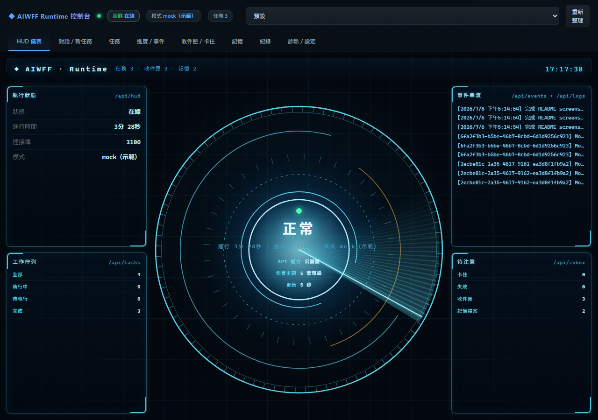

# 小主腦 安裝手冊

> 小主腦（專案名 `aiwff-runtime`）＝裝在你自己電腦上的小型 AI 主腦：丟一件事給它，它在背景把任務跑完，結果推回來，瀏覽器看得到進度。
>
> 這份是**安裝手冊**，教你怎麼把它裝起來、跑通第一次。學會裝好之後怎麼「用」它，見 [使用手冊 usage.md](usage.md)。
> 英文完整規格 → [../../README.md](../../README.md)。

## 一行安裝（Windows）

打開 PowerShell 或命令提示字元，貼這一行：

```powershell
powershell -NoProfile -ExecutionPolicy Bypass -Command "[Net.ServicePointManager]::SecurityProtocol='Tls12'; iwr -UseBasicParsing https://raw.githubusercontent.com/zaxardery8011-design/aiwff-runtime/master/install.ps1 -OutFile ([IO.Path]::GetTempPath()+'aiwff-install.ps1'); & ([IO.Path]::GetTempPath()+'aiwff-install.ps1')"
```

不用系統管理員權限，也不用先裝 Node 或 git。它會做這些事：

- 從官方來源下載免安裝版 Node、MinGit、pwsh，版本寫死，SHA256 對不上就中止；
- 抓 aiwff-runtime、soplint、execution-proofs 三個 repo，裝好依賴；
- 產生 `.env` 和登入 token（token 不會印在畫面上）；
- 問你三件事：要不要登入後自動啟動、接哪個大腦、要不要接 Claude 桌面端（有偵測到才問）；
- 跑一次 doctor，再問大腦一句話，確認它真的回得來；
- 在桌面放一個捷徑，打開瀏覽器。

下載和解壓要幾分鐘，這段沒有畫面是正常的。斷網中止時，再貼一次同一行，會從斷掉的地方接著裝。

預設裝到 `C:\AIWFF-<你的帳號>\`。帳號名裡只留英文、數字、`_` 和 `-`：全中文帳號會裝到 `C:\AIWFF-default\`，`小明 Lin` 會裝到 `C:\AIWFF-Lin\`。同一台電腦有兩個全中文帳號時，要用 `-Name` 或 `-Root` 分開，不然會共用同一個資料夾。畫面最後幾行會告訴你實際裝在哪、接的是什麼大腦、網址、下一步怎麼做。

安裝資料夾只開放給你的帳號、SYSTEM 和系統管理員：裡面有 token，也有開機會跑的程式。`-Root` 指到已經有其他檔案的資料夾時，權限不會動，畫面會警告；這種情況建議換一個新資料夾。

之後要開 WebUI：雙擊桌面的 AIWFF 捷徑（或安裝資料夾的 `open-webui.cmd`），它會自動登入。直接打網址不會登入。打第一句話要切到瀏覽器的「對話 / 新任務」分頁。

### 接大腦

| 選項 | 誰來回話 | 要花錢嗎 | 要先準備什麼 |
|---|---|---|---|
| Claude | 你電腦上的 Claude CLI | 用掉你的訂閱額度；環境或 `.env` 有 `ANTHROPIC_API_KEY` 時改走 API 計費 | 裝好 [Claude Code](https://code.claude.com/docs/en/setup) 或 [Claude 桌面端](https://claude.com/download)，再登入 |
| Ollama | 你電腦上的本機模型 | 不用 | 裝好 [Ollama](https://ollama.com/download) 並打開，至少有一個聊天模型（例如 `ollama pull qwen2.5:3b`） |
| 模擬 | 內建的固定回覆，沒接 AI | 不用 | 不用 |

安裝時選單直接按 Enter＝建議項。選到還不能用的項目，它會講原因和下載網址，裝好後回到同一個選單再選。之後想換：

1. 雙擊安裝資料夾的 `connect-brain.cmd`（開發環境也可以跑 `npm run connect`）。
2. 雙擊安裝資料夾的 `restart-runtime.cmd`，新的大腦才會生效。

要接 Claude 但還沒登入也沒關係：先選模擬裝完，雙擊 `claude-login.cmd` 登入，再做這兩步。

**接 Claude 的範圍**：聊天照常。背景任務只能改自己的工作資料夾，不能跑命令，見 3.3.3。

不想被問，可以直接指定：`-Brain claude`、`-Brain ollama`、`-Brain mock`。帶 `-Unattended` 卻沒帶 `-Brain` 時維持模擬：用掉你的額度，一定要你同意過。重裝時已經有 `.env`、又沒帶 `-Brain`，就不動你的設定；沒有人在場時也不會問大腦第一句。API 計費又沒有人在場時，就算帶了 `-Brain claude` 也不問。

每次改 `.env` 前，舊內容會存成 `.env.bak`，只留最近一份，裡面有 token，不要傳給別人。

### 接 Claude 桌面端

裝好後，同一顆小主腦在 Claude 桌面端也叫得到，做法和工具清單見 [desktop.md](desktop.md)。

### 移除

雙擊安裝資料夾的 `uninstall.cmd`。

它會停掉這個資料夾的小主腦、解除開機排程、拿掉桌面端接線和桌面捷徑。**資料不會刪**，最後會印出資料夾路徑，要全部刪掉請自己刪。

### 常用開關

要帶開關時，在 PowerShell 裡先下載再跑（`iwr` 只有 PowerShell 有，命令提示字元不行）：

```powershell
iwr -UseBasicParsing https://raw.githubusercontent.com/zaxardery8011-design/aiwff-runtime/master/install.ps1 -OutFile install.ps1
powershell -NoProfile -ExecutionPolicy Bypass -File .\install.ps1 -Name demo
```

- `-DryRun`：只列出計畫，什麼都不改；
- `-Root <資料夾>`：改安裝位置；
- `-SkipAutostart`：不設自動啟動；
- `-Unattended`：不問問題；
- `-UseSystemTools`：用電腦上已經有的 node 和 git；
- `-ConnectDesktop`、`-NoDesktop`：接或不接 Claude 桌面端，不問；
- `-ReplaceDesktop`：桌面端接著別的安裝資料夾時，換成這一個；
- `-NoShortcut`：不放桌面捷徑；
- `-NoBrowser`：裝完不開瀏覽器。

### 試裝

想在公開前試一個還沒合進 master 的分支，把上面下載網址的 `master` 換成分支名，再帶 `-Branch`：

```powershell
powershell -NoProfile -ExecutionPolicy Bypass -File .\install.ps1 -Root C:\AIWFF-try -Branch feat/xxx
```

`-Branch` 只影響 aiwff-runtime，另外兩個 repo 照舊。要用新的資料夾：同一個 `-Root` 裝過別的分支時，安裝會中止，不會幫你切換。

### 結束碼

| 碼 | 意思 |
|---|---|
| 0 | 完成。模擬也是 0，收尾畫面會寫「現在是模擬，還沒接 AI」 |
| 1 | 安裝出錯，畫面會寫原因；最常見是網路斷了，再貼一次同一行就會續裝。`-Mode uninstall`、`-Mode restart` 找不到安裝，或程序收不掉，也是 1 |
| 2 | 非互動環境沒指定開關，什麼都沒建 |
| 3 | `-Mode assess` 還沒做 |
| 4 | 裝好了，但健康檢查沒過，或 port 被別的程式佔著。`-Mode restart` 重開後沒回應也是 4 |
| 5 | 裝好了，但大腦沒回話，或你選的大腦沒接上。畫面會寫白話原因；修好後雙擊 `connect-brain.cmd`，再雙擊 `restart-runtime.cmd` |

這張表是 `powershell -File` 看到的。一行安裝走 `-Command`，外面只分得出 0 和 1，畫面的文字一樣。要在腳本裡判斷，下載後用 `-File` 跑。

**port 被佔著**：畫面會告訴你要改哪個檔的 `PORT`，改完再跑一次安裝。

想一步一步手動裝，或想看懂每一步在做什麼，往下看。

---

## §0 開始之前（這份手冊給誰、你會得到什麼）

**這份手冊給誰**

- 你想要一個**跑在自己電腦上**的 AI 任務助手，而不是又一個雲端聊天視窗。
- 你會用基本的命令列（會開終端機、會複製貼上命令就夠了）。
- 你**不需要**先懂多節點、伺服器、雲端部署——小主腦刻意只跑在你這一台機器上。

**你裝完會得到什麼**

- 一個本機常駐程式（daemon），負責建立任務、跑 worker、把結果寫成檔案。
- 一個瀏覽器控制台（WebUI，預設 `http://127.0.0.1:3100`），看任務狀態與產出。
- 一條完整跑通的「建任務 → 執行 → 寫結果」流程，全部留在你本機的檔案裡（`data/` 目錄下）。
- （可選）接上 Telegram，之後可以用手機傳訊息丟任務、收結果。

**先講最重要的一句：預設就能免費跑通。** 下面的手動安裝走的是 **mock（模擬）模式**，不需要任何 API key、不需要付費帳號、不需要 Telegram，就能看到一次完整的任務生命週期。要不要接「會真的呼叫 AI」的付費模式，是你**跑通 mock 之後**才需要做的選擇——費用怎麼算，下一節 §1 先講清楚，不讓你裝到一半才發現要付錢。

**這份手冊的路線圖**

| 章節 | 內容 | 你現在需要嗎 |
|---|---|---|
| §0 開始之前 | 你在讀的這節 | 是 |
| §1 前置需求與費用說明 | 要準備什麼、哪些免費哪些要付費 | 是（裝之前一定要看） |
| §2 mock 安裝與驗證 | 一步步把免費模式跑通 | 是 |
| §3 接上真的 AI | 離開 mock：接本機免費模型，或接付費 Claude；第一句對話回得來才算完成 | mock 跑通後就看 |
| §4 啟用 Telegram | 用手機傳訊息操作 | 之後想接手機再看 |
| §5 疑難排解與支援管道 | 卡住了怎麼辦、去哪求助 | 是 |

---

## §1 前置需求與費用說明（裝之前一定要先看）

### 1.1 你需要準備的東西

> 走最上面的一行安裝：Node、git 它會自己帶，不用先裝。這張表是手動安裝用的。

| 項目 | 需要嗎 | 怎麼確認 | 備註 |
|---|---|---|---|
| **Node.js 18 或以上** | ✅ 必要 | 終端機打 `node --version`，要 ≥ v18 | 唯一的硬需求。低於 18 請先升級 Node，本工具不會幫你動系統 Node |
| **git** | ✅ 必要 | `git --version` | 用來把程式抓下來（clone） |
| **npm** | ✅ 隨 Node.js 附帶 | `npm --version` | 裝 Node 就有；本專案**零外部相依**，`npm install` 是選填的 |
| **Claude CLI** | ⬜ 可選 | `claude --version` | **只有要跑「真 AI」時才需要**；不裝也能跑 mock 模式 |
| **Claude 付費訂閱** | ⬜ 可選 | 見 §1.3 | 同上，只有真 worker 模式才需要 |
| **Telegram Bot Token** | ⬜ 可選 | 見 §4 | 只有想用手機傳訊息時才需要 |

一句話：**只要有 Node.js 18+ 和 git，你就能免費把小主腦跑通。** 其他都是之後想升級才碰的。

### 1.2 兩種執行模式（先搞懂差別，再決定要不要花錢）

小主腦有兩種「大腦」可以用：

| 模式 | 誰在跑任務 | 要花錢嗎 | 適合 |
|---|---|---|---|
| **mock（模擬）模式** — 預設 | 內建的假 worker，走完整流程但不真的呼叫 AI | ❌ 完全免費 | 第一次安裝、驗證流程跑得通、看懂檔案長怎樣 |
| **real（真 Claude）模式** | 你本機的 Claude CLI，真的呼叫 Claude 執行 | ✅ 需要 Claude 付費訂閱 | 確認流程 OK 後，想讓它真的幫你做事 |

預設 `.env` 裡 `MOCK_WORKER=1`，也就是**開箱即 mock**。你要主動去開真 worker（見 §3），它才會花到錢——不會偷偷幫你切換。

### 1.3 費用誠實說明（重點，不藏）

> **真 Claude worker 需要付費的 Claude 訂閱。沒有訂閱，你只能跑 mock 模式。** 這件事在你裝之前就該知道，不是裝完才發現。

- 小主腦本身是 **MIT 授權、免費開源**，程式零外部相依，下載和跑 mock **不花一毛錢**。
- 但「真 worker」是叫用你本機的 **Claude CLI**，而 Claude CLI 要能真的執行，背後需要一個**付費的 Claude 訂閱帳號**登入。
- 費用層級與方案名稱會由 Anthropic 調整，本文不寫死價格。實務上你需要一個能使用 Claude CLI 的付費 Claude 帳號；輕量個人使用通常從入門付費方案評估，較高用量或較長任務再評估高用量方案。實際可用額度、價格與 CLI 權限，以你帳號當下顯示的官方資訊為準。
- **沒有訂閱怎麼辦？** 完全沒問題——**mock 模式永遠免費**，你可以用它把整套流程、WebUI、檔案格式全部摸熟，只是任務結果是模擬產物、不是真的 AI output。

> 小提醒：這裡不列死板價格數字，是因為訂閱方案與定價由 Anthropic 官方調整，寫死容易過時誤導。**要接真 worker 前，請先到 Anthropic 官網確認當前方案與價格**。

### 1.4 安全前提（一開始就講清楚）

- 你的任何密鑰（Telegram token、chat id）只會寫進本機 `.env`，這個檔已被 `.gitignore` 忽略，**不會進 git、不會外流**。
- 預設不接 Telegram、不開真 worker、不設任何「跳過核可」的旗標——這些都要你**主動確認**才會啟用。
- 如果你用 AI coding agent 幫你裝（見 §2），它遵循的安全契約寫在專案根目錄的 [`INSTALL_AI.md`](../../INSTALL_AI.md)：只在 repo 內動作、不讀你私人檔案、不把 secrets 進 git。

---

## §2 mock 安裝與驗證

跟著下面七步走，你會在**不花任何錢、不接任何帳號**的情況下，把一次完整的任務跑通。每步都附「你會看到什麼」，對不上就往 §5 找。

> 下面的命令與輸出，是在一台**乾淨環境**（全新 clone、沒有舊 `.env`、沒有舊 `data/`）實測記錄的。你機器上的 task id、時間戳、port 號會不一樣，但**輸出的形狀**應該一致。

### 步驟 1：把程式抓下來（clone）

```bash
git clone https://github.com/zaxardery8011-design/aiwff-runtime
cd aiwff-runtime
```

你會看到 `Cloning into 'aiwff-runtime'... done.`，然後多出一個 `aiwff-runtime` 資料夾。**之後所有命令都在這個資料夾裡跑**（先 `cd` 進來）。

### 步驟 2：確認環境版本

```bash
node --version   # 要 >= v18
npm --version
git --version
```

實測輸出（你的數字可能不同，只要 Node 是 18 以上就行）：

```text
v22.16.0
10.9.2
git version 2.54.0.windows.1
```

Node 低於 v18 就先去 [Node.js 官網](https://nodejs.org/) 升級，再回來。本工具**不會**幫你動系統 Node。

### 步驟 3：建立 `.env` 設定檔

把範例檔複製成 `.env`：

- **Windows PowerShell**：`Copy-Item .env.example .env`
- **bash / macOS / Linux**：`cp .env.example .env`

複製完的 `.env` 裡，`MOCK_WORKER=1`、`PORT=3100` 已經是預設值，**mock 模式開箱即用，不用改任何一行**。Telegram 與真 worker 的欄位都留空，代表都不啟用（要開再看 §3、§4）。

### 步驟 4：（可選）`npm install`

本專案**零外部相依**，這步是選填的。跑了也只會確認沒有東西要裝：

```bash
npm install
```

實測輸出：

```text
up to date, audited 1 package in 17s

found 0 vulnerabilities
```

看到 `audited 1 package`（就是專案自己）＋ `0 vulnerabilities`，代表「免相依」這句是真的。想省事，這步可以直接跳過。

### 步驟 5：自檢（doctor）

```bash
npm run doctor
```

doctor 會檢查三件事：Node 版本、`data/tasks` 能不能建立、預設 port 3100 有沒有被占用。**全綠**時你會看到：

```text
PASS Node.js version v22.16.0 >= 18
PASS data/tasks can be created at data\tasks
PASS port 3100 is available
✓ Doctor passed — ready to run demo
```

如果 port 3100 剛好被別的程式占用，最後兩行會變成（這是**警告不是錯誤**，可以繼續，或照 §5 換 port）：

```text
WARN port 3100 is already in use
Doctor completed with warnings — stop the process using the port before running the default demo
```

### 步驟 6：跑一次完整任務（demo）

```bash
npm run demo
```

這會用內建的 mock worker，走完一次「建立任務 → 執行 → 寫產出」。實測輸出：

```text
AIWFF Runtime listening on http://127.0.0.1:54330
Task ID: 10fe665b-ffc3-4099-9d27-8cfd552cb17d
Artifact: ...\data\artifacts\10fe665b-ffc3-4099-9d27-8cfd552cb17d.result.json
Status: done
✓ Demo completed — task lifecycle verified
```

**把這行的 `Task ID` 與 `Artifact` 路徑記下來**——那就是這次任務的成品位置。（demo 腳本會自動找一個空 port，所以上面顯示的 `54330` 只是範例，跟你 WebUI 用的 3100 是兩回事。）

### 步驟 7：驗證產出（verify-demo）

```bash
npm run verify-demo
```

這支會去檢查最新的 `.result.json` 是否存在、非空、`completed_at` 有值、任務狀態是 `done`。三行 `PASS` 就代表流程真的跑通了：

```text
PASS artifact exists and is non-empty: ...\data\artifacts\10fe665b-...result.json
PASS artifact completed_at present: 2026-07-05T13:47:39.516Z
PASS task status is done: 10fe665b-ffc3-4099-9d27-8cfd552cb17d
```

### 步驟 8：開瀏覽器控制台（WebUI）

```bash
npm run web        # 等同 npm start，兩個指令都會起同一個 WebUI
```

看到 `AIWFF Runtime listening on http://127.0.0.1:3100` 後，**用瀏覽器打開終端機印出的登入連結**（下一行 `登入 WebUI：http://127.0.0.1:3100/?token=...`），就會登入並看到控制台首頁（HUD 分頁）。直接開 `http://127.0.0.1:3100` 也看得到畫面，但沒登入時「對話」分頁不能建立任務；沒在 `.env` 設 `AIWFF_RUNTIME_TOKEN` 的話，每次重啟連結都會換新，要重點一次：



> **換 port**：3100 被占用時，`npm run web` 不會自動換 port：它會印出 `failed to bind http://127.0.0.1:3100: EADDRINUSE` 和下面兩行換 port 的指令，然後結束（exit code 1）。這時 Windows PowerShell 用 `$env:PORT=3200; npm run web`，bash / macOS / Linux 用 `PORT=3200 npm run web`，再開 `http://127.0.0.1:3200`。

裝到這裡，你已經有一個**完全免費、跑在自己電腦上**的 AI 任務助手骨架了。接下來怎麼用它建任務、看產出，見 [使用手冊 usage.md](usage.md)。

> **注意：到這裡還是 mock，還沒接任何 AI 模型。** 打字只會收到示範產物，不是真的回答。要它第一次真的回你話，接著做 §3（有免費的本機模型路線）。

> **關於 port 的一個誠實註記**：本節步驟 5 的「全綠」輸出，是在 port 3100 空著的乾淨機上驗到的預期樣子；我們自己的實測機因為 3100 已被其他服務占用，實際跑到的是上面那段 **WARN** 分支——兩條路徑都列在這裡，你落到哪條都有對照。

---

## §3 接上真的 AI

§2 做完，你的小主腦已經裝好、跑起來了，但它還是 **mock（模擬）**：你打什麼，它都只回示範產物，**還沒有接任何 AI 模型**。這一章教你接上真的模型，讓它第一次真的回你話。

> **用一行安裝的人**：雙擊安裝資料夾的 `connect-brain.cmd` 選大腦，再雙擊 `restart-runtime.cmd`，就可以直接跳到 3.4。3.2、3.3 是手動改 `.env` 的做法。

### 3.0 先確認：我現在是不是還在 mock？

符合下面任一條，你就還在 mock：

- WebUI 首頁（HUD）的「模式」顯示 `mock（示範）`。
- 在「對話」分頁送一句話，回的是固定句 `（mock）收到你的訊息。…`，不是在回答你。

這不是壞掉，是預設就這樣（見 §1.2）。往下選一條路接上模型。

### 3.1 選一條路

| 路線 | 誰來回話 | 要花錢嗎 | 能做什麼 | 適合 |
|---|---|---|---|---|
| **A. 本機模型（OpenAI 相容端點）** | 你自己電腦上跑的模型，例如 ollama | ❌ 不用金鑰、不用訂閱 | 只回文字：問答、摘要、分類、改寫；**不能動檔案、不能跑工具** | 想先免費看到它真的回話 |
| **B. 真 Claude worker** | 你本機的 Claude CLI | ✅ 需要 Claude 付費訂閱（見 §1.3） | 聊天回話；任務只能改自己的工作資料夾，不能跑命令（見 3.3.3） | 要 Claude 來回話 |

兩條路都是改 `.env` 再重開 `npm run web`，不會自動切換。走完任一條，都到 3.4 做同一個完成測試。

### 3.2 路線 A：接本機模型（以 ollama 為例）

1. **裝 ollama 並下載一個模型**。到 ollama 官網安裝後，在終端機下載一個你電腦跑得動的模型，再確認它在清單裡：

   ```bash
   ollama pull <模型名稱>
   ollama list
   ```

   模型越大越吃記憶體與顯示卡；第一次先挑小一點的，能回話再換。`ollama list` 顯示的名稱（例如 `qwen3:32b`）等一下要**一字不差**填進 `.env`。

2. **改 `.env`**（在 repo 根目錄）：

   ```env
   MOCK_WORKER=
   AIWFF_WORKER_PROVIDER=openai_compatible
   AIWFF_OPENAI_BASE_URL=http://127.0.0.1:11434/v1
   AIWFF_OPENAI_MODEL=<ollama list 顯示的名稱>
   ```

   - `MOCK_WORKER` **一定要清空**（或設 `0`）。它的優先權最高，留著 `1` 就永遠是 mock。
   - 請直接**改掉原本那一行**，不要在檔尾另外加一行：`.env` 裡同一個名稱寫兩次時，只有第一次出現的那行會生效，原本的 `MOCK_WORKER=1` 會蓋掉你後面加的。
   - 網址要帶 `/v1`；`11434` 是 ollama 的預設 port。用 LM Studio、vLLM 等其他 OpenAI 相容服務，換成它們的網址即可。
   - `AIWFF_OPENAI_API_KEY` 本機 ollama 不用填；服務要金鑰才填，它只寫在你本機 `.env`，不進 git（§1.4）。

3. **重開 runtime**：先在跑 `npm run web` 的終端機按 `Ctrl+C` 停掉，再跑一次 `npm run web`。用一行安裝的沒有這個終端機，改雙擊 `restart-runtime.cmd`。HUD 的「模式」會變成 `openai_compatible`。

接著做 3.4 的完成測試。

### 3.3 路線 B：啟用真 Claude worker

真 worker 會呼叫你本機的 Claude CLI，所以這一步會使用你的 Claude 帳號與訂閱額度。

#### 3.3.1 確認 Claude CLI 可用

在 repo 根目錄執行：

```bash
claude --version
```

如果系統找不到 `claude`，到 [Claude Code 官方安裝頁](https://code.claude.com/docs/en/setup) 裝好。CLI 要求你先登入時，跑 `claude auth login`，或雙擊安裝資料夾的 `claude-login.cmd`。這份手冊不替你建立帳號、購買方案，也不替你跳過 Claude CLI 的安全提示。

#### 3.3.2 修改 `.env`

把 mock 關掉，並明確開啟 real worker：

```env
MOCK_WORKER=0
ENABLE_REAL_CLAUDE_WORKER=1
CLAUDE_CMD=claude
CLAUDE_BYPASS_APPROVALS=
AIWFF_CLAUDE_PERMISSION_MODE=acceptEdits
```

`MOCK_WORKER=1` 會強制走 mock；要跑真 worker，請把它設成 `0` 或留空。`ENABLE_REAL_CLAUDE_WORKER=1` 也一定要設：只清 `MOCK_WORKER` 的話，它會靜靜留在 mock。`CLAUDE_BYPASS_APPROVALS` 預設留空，代表不加 `--dangerously-skip-permissions`。`AIWFF_CLAUDE_PERMISSION_MODE=acceptEdits` 讓背景任務寫得了檔，只收這個值，範圍見 3.3.3。`npm run connect` 選 Claude 時會一起寫好。

#### 3.3.3 重開 runtime

先按 `Ctrl+C` 停掉原本的 `npm run web`，再跑一次（用一行安裝的改雙擊 `restart-runtime.cmd`）：

```bash
npm run web
```

HUD 的「模式」會變成 `claude（真實 worker）`。真 worker 產出的最後一行應符合 `CLAUDE.md` 契約，寫成 `DONE: ...`。

工具要經過核可是正常的安全設計，不要為了省事開 bypass。想先驗流程，回到 `MOCK_WORKER=1` 用免費 mock 模式。

> **Claude 大腦的任務能做什麼**：任務在背景跑，沒有人按允許，所以範圍是事先定好的。
>
> - 只能改自己的工作資料夾（`data/workspaces/<任務 id>`）。別的地方寫不進去，別件任務的結果也碰不到：結果先寫在工作資料夾，跑完才由小主腦收進 `data/artifacts`。
> - 工具只有讀檔、寫檔、改檔、找檔。不能跑命令、程式或腳本，安裝套件這類工作做不了，也不能上網，你在 Claude 裝的 MCP 連接器這裡不會載入。
> - 例外：如果你在 Claude 的全域設定放行過讀寫檔（`permissions.allow` 有 `Read`、`Write`、`Edit`），背景任務會跟著放寬，讀寫得到工作資料夾外面，`.env` 也包含在內。跑命令的工具不受影響，一樣沒有。
> - 做不到的工作會停在「等你回答」，問能不能開放權限。這種問題到 WebUI 回答也解不開，只是再花一次額度。
>
> **舊安裝**：`.env` 沒有 `AIWFF_CLAUDE_PERMISSION_MODE=acceptEdits` 時，真任務連結果檔都寫不了，會停在「等你回答」，也有可能重試 3 次才停。重裝時不會自動改你的 `.env`，要自己開：跑 `npm run connect`（或雙擊 `connect-brain.cmd`）選 Claude，再重開小主腦。

接著做 3.4 的完成測試。

### 3.4 完成測試：第一句對話回得來

不管走 A 還是 B，都用同一個方式確認：

1. 在 WebUI 切到「對話 / 新任務」分頁，送一句：`你好，用一句話介紹你自己。`
2. 等幾秒，回答會直接出現在對話框裡，不用開檔案。
3. 判斷：

| 你看到的 | 代表 |
|---|---|
| 對話框出現一段真的在回答你的文字 | ✅ **接上了，這章完成**。之後怎麼給它個性與記憶，見 [usage.md](usage.md) §6 |
| 對話框出現 `（mock）收到你的訊息。…` | ❌ 還在 mock：`MOCK_WORKER` 沒清空，或改完 `.env` 沒重開 |
| 對話框出現錯誤訊息 | ❌ 有設定沒接好，看 3.5 |
| 跳出「要建任務嗎」的確認卡 | 不是壞掉。這句話像指令，它想建成任務；換一句問句再試 |

### 3.5 接不上時先對這張表

對話失敗的原因會直接出現在對話框。任務失敗的原因會顯示在 WebUI「任務」分頁那筆任務底下，也會記在 `data/tasks/<task_id>.progress.jsonl`。

| 你看到的錯誤 | 原因 | 處理 |
|---|---|---|
| `AIWFF_OPENAI_BASE_URL and AIWFF_OPENAI_MODEL are required ...` | 路線 A 的網址或模型名稱沒填 | 補齊 3.2 的兩行，重開 `npm run web` |
| `fetch failed`、連線被拒 | ollama 沒在跑，或網址／port 不對 | 確認 ollama 有開、`ollama list` 能跑；網址是 `http://127.0.0.1:11434/v1` |
| `HTTP 404`，訊息提到 model | 模型名稱跟 `ollama list` 不一致，或還沒 `ollama pull` | 從 `ollama list` 複製名稱貼進 `AIWFF_OPENAI_MODEL` |
| 等很久最後逾時 | 模型太大，電腦跑不動或第一次載入很慢 | 換小一點的模型，或第一次送出後多等一下再試 |
| 找不到 `claude` 命令 | 路線 B 沒裝 Claude CLI，或 Windows 的 PATH 找不到 `claude.cmd` | 先讓 `claude --version` 能跑。只裝 Claude 桌面端的話，`start-runtime.cmd` 每次啟動會自己找內附版，雙擊 `restart-runtime.cmd` 再試。`CLAUDE_CMD` 不要設成含空白的完整路徑，runtime 跑不起來；把那個資料夾加進 PATH |
| 模式還是 `mock（示範）` | `MOCK_WORKER` 還是 `1`、接 Claude 卻沒設 `ENABLE_REAL_CLAUDE_WORKER=1`，或沒重開 | 雙擊 `connect-brain.cmd`（開發環境跑 `npm run connect`）重選一次，或照 3.2、3.3 補齊，再重開 |

都對不上：到 §5.2 開 Issue，附上你選的路線、`.env` 裡跟模型有關的幾行（**金鑰遮掉**）和完整錯誤訊息。

---

## §4 啟用 Telegram

Telegram 是可選入口；不接 Telegram 時，WebUI 和 mock demo 仍可正常使用。這條路使用 polling，不需要 webhook、公開 hostname、反向代理或公開 IP。

### 4.1 建 bot 與取得 chat id

1. 在 Telegram 搜尋 `@BotFather`。
2. 傳 `/newbot`，照提示建立 bot，複製它給你的 token。
3. 搜尋 `@userinfobot`。
4. 傳任意訊息，複製你的數字 chat id。

### 4.2 填入 `.env`

```env
TG_BOT_TOKEN=<BotFather 給你的 token>
ADMIN_TG_CHAT_ID=<你的數字 chat id>
```

`ADMIN_TG_CHAT_ID` 是必要安全邊界：只有這個 chat id 的訊息會被接受。若 `TG_BOT_TOKEN` 有值但 `ADMIN_TG_CHAT_ID` 留空，runtime 會拒絕啟動 Telegram polling，WebUI 則照常可用。

### 4.3 啟動與測試

重新啟動 runtime：

```bash
npm run web
```

接著在 Telegram 對你的 bot 傳：

- `/start`：確認 bot 有回應。
- `/tasks`：查看最近任務。
- 任意文字：建立一筆任務；完成後 bot 會推送完成或失敗通知。

如果 bot 沒反應，先看終端機是否出現 `Refusing Telegram polling: ADMIN_TG_CHAT_ID is required when TG_BOT_TOKEN is set.`，再確認 `.env` 裡 token 與 chat id 都已填入。

---

## §5 疑難排解與支援管道

### 5.1 常見問題

| 症狀 | 可能原因 | 處理方式 |
|---|---|---|
| `node --version` 顯示低於 v18 或找不到命令 | 沒裝 Node 或版本太舊 | 先到 Node.js 官網裝 18 以上，再重跑安裝 |
| WebUI 起不來、說 port 被占用 | 預設 `3100` 已被別的程式使用 | 換一個 port：bash 用 `PORT=3200 npm run web`；**Windows PowerShell 要寫成** `$env:PORT=3200; npm run web` |
| PowerShell 設環境變數沒效果 | 用了 bash 的 `VAR=value 命令` 寫法 | Windows PowerShell 改用 `$env:VAR='value'; 命令`（bash / macOS / Linux 才用前綴寫法） |
| 跑完 demo 找不到產出 | 沒看 demo 輸出裡印的路徑，或終端機在錯的目錄 | 確認你在 repo 根目錄；mock 產出在 `data/artifacts/<task_id>.result.json` |
| Telegram 一直不啟動 | `TG_BOT_TOKEN` 有填但 `ADMIN_TG_CHAT_ID` 留空 | 補上你的數字 chat id 再重跑（見 §4） |
| 真任務停在等你回答，問能不能開放權限 | 這件工作超出範圍，背景又沒有地方按允許（見 3.3.3） | 不要設 bypass 旗標去跳過。舊安裝先跑 `npm run connect`（或雙擊 `connect-brain.cmd`）選 Claude；已經開放還是問，就是這件工作要跑命令或動別的資料夾，改用聊天或自己動手 |

> 更多開發者向的排錯，見專案 [`INSTALL_AI.md`](../../INSTALL_AI.md) 第 6 節與 [`docs/architecture.md`](../architecture.md)。

### 5.2 支援管道

- **技術回報**：到 GitHub 開 Issue → <https://github.com/zaxardery8011-design/aiwff-runtime/issues>。如果目前無法建立 issue，請改從 <https://zax.com.tw/?utm_source=github_aiwff-runtime&utm_campaign=install_support> 聯絡。回報時附上作業系統、Node 版本、你跑的命令與完整錯誤訊息，能幫我們更快定位。
- **想要完整版 / 客製化**：<https://zax.com.tw/?utm_source=github_aiwff-runtime&utm_campaign=install_support>

---

*小主腦（`aiwff-runtime`）· MIT 授權*
